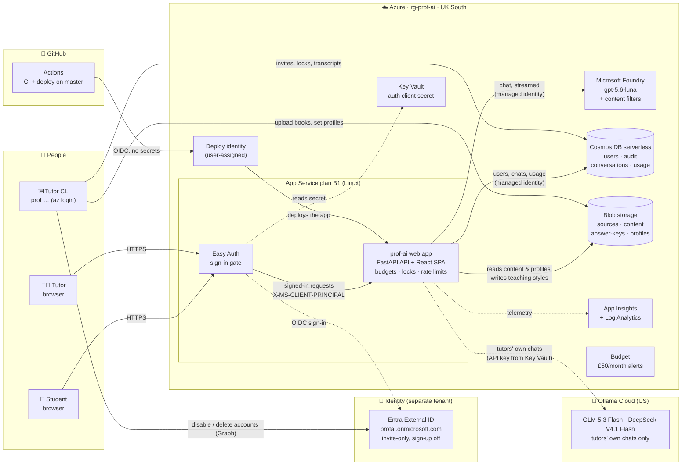
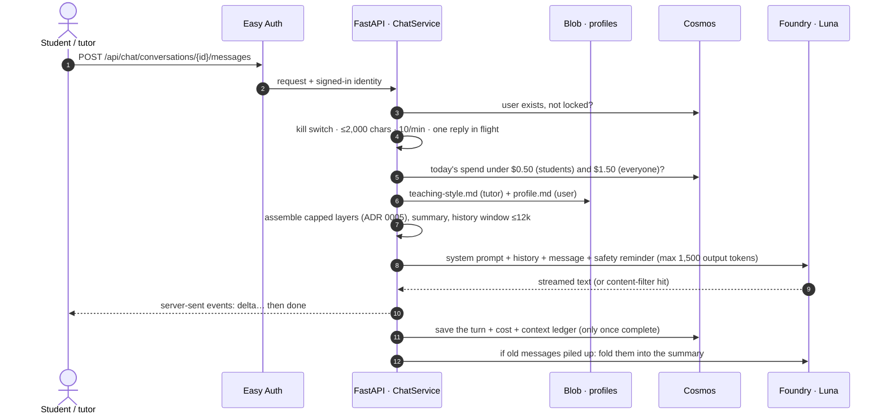

<div align="center">

# 🎓 Prof AI

**Your tutor, between lessons.**

An AI-assisted tutoring platform for grades 6–12, built *around* a human tutor rather than replacing one.

[](https://github.com/Samrudh-Anavatti/prof-ai/actions/workflows/ci.yml)
[](https://github.com/Samrudh-Anavatti/prof-ai/actions/workflows/deploy.yml)

[**Open the app**](https://prof-ai.azurewebsites.net) · [Feature index](docs/features/INDEX.md) · [Vision](docs/product/vision.md) · [Architecture](docs/product/architecture.md) · [Risks](docs/product/risks.md) · [CLAUDE.md](CLAUDE.md)

</div>

> [!WARNING]
> **Proof of concept: not for real students yet.** Only invited tutors and synthetic test accounts should use it. The guard pipeline, parental consent, a retention policy and a decision on data residency (R16) must land first. See [Open items](#-open-items).

## Contents

- [The idea](#-the-idea)
- [Where we are](#-where-we-are)
- [🆕 Latest](#-latest)
- [Links](#-links)
- [Azure architecture](#-azure-architecture)
- [How a chat turn works](#-how-a-chat-turn-works)
- [Decisions and direction](#-decisions-and-direction)
- [Open items](#-open-items)
- [Run it locally](#-run-it-locally)
- [Tutor CLI](#-tutor-cli)
- [Repo tour](#-repo-tour)
- [How we work](#-how-we-work)

---

## 💡 The idea

A tutor teaches a live lesson and assigns a chapter and questions. During the week, each student works on the platform:

```
  Teach ──► Assign ──► Practise ──► Mark ──► Re-explain ──► Review
 (tutor)   (tutor)    (student)   (software    (student's     (tutor sees
                                   + AI)       guarded AI)    everything)
```

The student's assistant **coaches rather than hands over answers**, stays **grounded in the tutor's own content**, and is **heavily guarded**. The tutor sees results, transcripts, flags and usage before the next lesson. First users: Sam and Punji as tutors, with 5–6 students each. More in [vision.md](docs/product/vision.md).

## 📍 Where we are

| | Area | State |
|---|------|-------|
| ✅ | **Infra**: App Service, Foundry, Cosmos, Blob, Key Vault, budget alerts, all in Bicep | Live |
| ✅ | **Sign-in**: Entra External ID with email-code sign-up; only invited emails get in; per-request account locks | Live |
| ✅ | **Content store**: upload textbooks with `prof content add-book` | Live (CLI) |
| ✅ | **Web app**: React SPA served by FastAPI on one origin, strict CSP; friendly, readable design for ages 11–18 | Live |
| ✅ | **Tutor chat with Luna**: streamed replies, transcripts, per-user budgets and kill switch | Live |
| ✅ | **Per-user AI configuration**: tutor teaching style + per-user profile in the system prompt | Live |
| ✅ | **Teaching style editor** in the web UI for tutors | Live |
| ✅ | **Users admin page**: invite, lock, unlock and delete; admins manage everyone | Live |
| ✅ | **Context budget**: capped prompt layers that fit our 50k tokens a minute, rolling summaries, dollar budgets ([ADR 0005](docs/decisions/0005-models-and-context-budget.md)) | Live |
| ✅ | **Dilution eval** (`prof eval dilution`): safety and coaching hold at lesson sizes up to 40k | Live |
| ✅ | **Lessons**: tutors set up chats per lesson (5 per student) with PDF material capped at 12k | Live |
| ✅ | **Shared chats**: tutor and student in one lesson chat; Prof AI answers students by default and tutors on `@AI` | Live |
| ✅ | **Support levels**: step by step, balanced or stretch per lesson; lesson chats stay on the lesson | Live |
| ✅ | **Model providers**: Ollama Cloud alongside Luna, a model picker per lesson; only approved models reach students | Live |
| ✅ | **Maths rendering**: Markdown and typeset maths in Prof AI's replies | Live |
| ✅ | **Worksheet extraction**: questions, answers and worked examples drafted from a worksheet PDF for the tutor to review | Live |
| ✅ | **Student lesson page**: worked examples, questions one at a time, help buttons, *Check my answer*, per-question progress | Live |
| ✅ | **Describe it instead**: draft a lesson's fields from a description, with a checklist of what to cover | Live after merge |
| ✅ | **Show your working**: step-by-step working with a live maths preview, hints as you go, four-way marking, missing answers worked out for the tutor to confirm | Live after merge |
| 🔜 | **Knowledge graph**: chapter extraction and curricula, filling the reference layer (4k for now) | Planned |
| 🔜 | **Guard pipeline**: Prompt Shields, topic checks, safeguarding flags, auto-lock | Required before real students |
| ⬜ | Formal marking and a tutor dashboard across students | Phase 1, later |

The live list is [docs/features/INDEX.md](docs/features/INDEX.md).

## 🆕 Latest

> Whoever merges a feature updates this section (rule in [CLAUDE.md](CLAUDE.md)), so the other person can see what changed at a glance.

### Show your working · 2026-10-22 · Punji

A question is now done when the student shows working that gets to the right answer, not when they type the answer ([ADR 0006](docs/decisions/0006-worksheet-first-lessons.md) amendment, **proposed**).

- **Students write their working step by step,** typing maths the calculator way (`x^2`, `3/4`, `sqrt(10)`), and see it typeset live under each line.
- ***Check my working so far*** gives a hint at the step they're on, without marking.
- ***Submit my answer*** returns one of four verdicts: *Correct* (with *Next question*), *Show your working*, *Nearly* or *Not yet*. Feedback never gives the answer, and you see every attempt's working.
- **Missing answer keys:** *Work out missing answers* on the Lessons page has Prof AI solve them. You confirm each one before saving.
- **For Sam:** MathLive (Desmos-style maths input) needs a security-policy change. See *Decisions for Sam* below.

📄 [plan](docs/features/2026-10-22-show-your-working/plan.md) · [handover](docs/features/2026-10-22-show-your-working/handover.md)

<details>
<summary><b>Earlier features</b></summary>

| Date | Feature | Owner | Docs |
|------|---------|-------|------|
| 2026-10-22 | **Describe it instead**: draft a lesson's title, topics, notes and support level from one description, with a checklist of what to cover | Punji | [handover](docs/features/2026-10-22-describe-lesson/handover.md) |
| 2026-10-22 | **Student lesson page**: worked examples first, questions one at a time with help buttons, *Check my answer* that never gives the answer, per-question progress | Punji | [handover](docs/features/2026-10-22-student-lesson-page/handover.md) |
| 2026-10-21 | **Worksheet extraction**: questions, tutor-only answers and worked examples drafted from a worksheet PDF and reviewed on the Lessons page | Punji | [handover](docs/features/2026-10-21-worksheet-extraction/handover.md) |
| 2026-10-21 | **Maths rendering**: Markdown and typeset maths (KaTeX to MathML) in Prof AI's replies | Punji | [handover](docs/features/2026-10-21-maths-rendering/handover.md) |
| 2026-10-21 | **Model providers**: one OpenAI-compatible adapter, Ollama Cloud models for tutors' own chats, `approved_for_student_conversations` enforced, a model picker per lesson | Punji | [handover](docs/features/2026-10-21-model-providers/handover.md) |
| 2026-10-21 | **Lesson behaviour**: support levels per lesson, lesson chats stay on the lesson, Prof AI answers students without `@AI`, learning-science register | Punji | [handover](docs/features/2026-10-21-lesson-behaviour/handover.md) |
| 2026-10-20 | **Web app refresh**: Lexend, friendlier chat bubbles, starter prompts, tidier tutor pages, dark mode | Sam | [handover](docs/features/2026-10-20-web-refresh/handover.md) |
| 2026-10-20 | **Shared chats with @AI**: tutor and student share each lesson chat; Prof AI replies only to `@AI` | Sam | [handover](docs/features/2026-10-20-shared-chat/handover.md) |
| 2026-10-20 | **Lessons**: tutors set up chats per lesson (5 per student) with PDF material capped at 12k | Sam | [handover](docs/features/2026-10-19-lessons/handover.md) |
| 2026-10-19 | **Dilution eval** (`prof eval dilution`): rules hold 3/3 at lessons up to 40k; hardened prompt; safer filtered message; caps fit 50k tokens a minute | Sam | [handover](docs/features/2026-10-19-context-dilution-eval/handover.md) |
| 2026-10-19 | **Context budget**: capped prompt layers, rolling summaries, dollar budgets ($0.50/student, $1.50 global a day), a context ledger per reply | Sam | [ADR 0005](docs/decisions/0005-models-and-context-budget.md) · [handover](docs/features/2026-10-19-context-budget/handover.md) |
| 2026-10-18 | **Users admin page**: invite, lock, unlock and delete at `/users`; email-code sign-up ([create-account link](https://prof-ai.azurewebsites.net/.auth/login/aad?prompt=create&post_login_redirect_uri=/)) | Sam | [handover](docs/features/2026-10-18-user-admin/handover.md) |
| 2026-10-18 | **Teaching style editor**: edit and try your teaching style in the web app | Sam | [handover](docs/features/2026-10-18-teaching-style-editor/handover.md) |
| 2026-10-18 | **Tutor chat PoC**: chat with Luna, per-user profiles, budgets, transcripts CLI | Sam | [handover](docs/features/2026-10-18-tutor-chat/handover.md) |
| 2026-10-18 | **Frontend skeleton**: React SPA served by FastAPI | Sam | [handover](docs/features/2026-10-18-frontend-skeleton/handover.md) |
| 2026-10-14 | **Auth**: invite-only sign-in, users, locks | Sam | [handover](docs/features/2026-10-14-auth/handover.md) |
| 2026-10-14 | **Content store**: upload textbooks | Sam | [handover](docs/features/2026-10-14-content-store/handover.md) |
| 2026-10-14 | **App skeleton and Azure infra** | Sam | [handover](docs/features/2026-10-14-app-skeleton-infra/handover.md) |

</details>

## 🔗 Links

**App and code**

| What | Link |
|------|------|
| Live app | https://prof-ai.azurewebsites.net |
| Health check (no sign-in) | https://prof-ai.azurewebsites.net/healthz |
| Teaching style editor (tutors) | https://prof-ai.azurewebsites.net/teaching-style |
| Users admin (tutors) | https://prof-ai.azurewebsites.net/users |
| **Create-account link for invited people** | https://prof-ai.azurewebsites.net/.auth/login/aad?prompt=create&post_login_redirect_uri=/ |
| Repository | https://github.com/Samrudh-Anavatti/prof-ai |
| Pull requests | https://github.com/Samrudh-Anavatti/prof-ai/pulls |
| CI / deploy runs | https://github.com/Samrudh-Anavatti/prof-ai/actions |

**Azure** (resource group `rg-prof-ai`, UK South, "Subscription 1"; sign in with your workforce account)

| What | Link |
|------|------|
| Resource group | [rg-prof-ai](https://portal.azure.com/#resource/subscriptions/7dc9c954-db74-400c-8314-862146e62259/resourceGroups/rg-prof-ai/overview) |
| App Service | [prof-ai](https://portal.azure.com/#resource/subscriptions/7dc9c954-db74-400c-8314-862146e62259/resourceGroups/rg-prof-ai/providers/Microsoft.Web/sites/prof-ai/appServices) · [log stream](https://portal.azure.com/#resource/subscriptions/7dc9c954-db74-400c-8314-862146e62259/resourceGroups/rg-prof-ai/providers/Microsoft.Web/sites/prof-ai/logStream) · [configuration](https://portal.azure.com/#resource/subscriptions/7dc9c954-db74-400c-8314-862146e62259/resourceGroups/rg-prof-ai/providers/Microsoft.Web/sites/prof-ai/environmentVariablesAppSettings) (`CHAT_ENABLED` kill switch lives here) |
| Microsoft Foundry | [foundry-prof-ai](https://portal.azure.com/#resource/subscriptions/7dc9c954-db74-400c-8314-862146e62259/resourceGroups/rg-prof-ai/providers/Microsoft.CognitiveServices/accounts/foundry-prof-ai/overview) · [Foundry portal](https://ai.azure.com) |
| Cosmos DB | [cosmos-prof-ai](https://portal.azure.com/#resource/subscriptions/7dc9c954-db74-400c-8314-862146e62259/resourceGroups/rg-prof-ai/providers/Microsoft.DocumentDB/databaseAccounts/cosmos-prof-ai/dataExplorer) (Data Explorer) |
| Blob storage | [stprofaicjzzqh](https://portal.azure.com/#resource/subscriptions/7dc9c954-db74-400c-8314-862146e62259/resourceGroups/rg-prof-ai/providers/Microsoft.Storage/storageAccounts/stprofaicjzzqh/containersList) (containers) |
| Key Vault | [kv-prof-ai-cjzzqh](https://portal.azure.com/#resource/subscriptions/7dc9c954-db74-400c-8314-862146e62259/resourceGroups/rg-prof-ai/providers/Microsoft.KeyVault/vaults/kv-prof-ai-cjzzqh/secrets) |
| Application Insights | [appi-prof-ai](https://portal.azure.com/#resource/subscriptions/7dc9c954-db74-400c-8314-862146e62259/resourceGroups/rg-prof-ai/providers/Microsoft.Insights/components/appi-prof-ai/overview) |
| Budgets (£50/month alert) | [Cost Management budgets](https://portal.azure.com/#view/Microsoft_Azure_CostManagement/Menu/~/budgets) |
| Entra External ID (student and tutor accounts) | [profai.onmicrosoft.com](https://entra.microsoft.com/profai.onmicrosoft.com) (use this tenant-scoped URL; the plain one shows a 401) |

**Docs**

| What | Link |
|------|------|
| Feature index (read first) | [docs/features/INDEX.md](docs/features/INDEX.md) |
| Vision, architecture, risk register | [vision](docs/product/vision.md) · [architecture](docs/product/architecture.md) · [risks](docs/product/risks.md) · [learning science](docs/product/learning-science.md) |
| Decisions (ADRs) | [0001 stack](docs/decisions/0001-stack.md) · [0002 auth](docs/decisions/0002-auth-and-users.md) · [0003 frontend](docs/decisions/0003-frontend.md) · [0004 invites](docs/decisions/0004-invites-and-sign-up.md) |
| Agent and contributor rules | [CLAUDE.md](CLAUDE.md) |

## ☁️ Azure architecture

Everything lives in **`rg-prof-ai`** (UK South), defined in [`infra/main.bicep`](infra/main.bicep), tagged `project=prof-ai`, `owner=sam|punji`. **No keys anywhere**: services talk with managed identities, deploys use GitHub OIDC, and local dev uses your `az login`. The only secret (Easy Auth's client secret) sits in Key Vault.



### What each service does

| Service | Resource | Role in Prof AI | Who can reach it | Approx. cost |
|---------|----------|-----------------|------------------|--------------|
| **App Service** (Linux B1) | `prof-ai` on `plan-prof-ai` | Runs one FastAPI app that serves both the JSON API (`/api/*`) and the built React app. Owns every rule: sign-in check, account locks, budgets, rate limits and every model call. The browser never talks to a model directly. | The public internet, but only through Easy Auth | ~£10/month fixed |
| **Easy Auth** (App Service Authentication) | config on `prof-ai` | Forces sign-in on every path except `/healthz` and hands the app a trusted identity header. | n/a | free |
| **Entra External ID** | `profai.onmicrosoft.com` | Holds student and tutor accounts in a tenant **separate** from the one that controls Azure, so a child's account has no reach into infra. Anyone can sign up with an email code, but the app only admits emails a tutor invited ([ADR 0004](docs/decisions/0004-invites-and-sign-up.md)). The web app never calls Graph. | Tutors (admin) via CLI/portal | free at our scale |
| **Microsoft Foundry** | `foundry-prof-ai`, deployment `gpt-5.6-luna` (GlobalStandard, 10k TPM) | The tutor model ("Luna"). Content filters (DefaultV2) run on input and output. Key auth is disabled. | App and tutors (Entra role) | pay per token |
| **Cosmos DB** (serverless) | `cosmos-prof-ai`, database `prof-ai` | App data: `users` (role, status, tutor), `audit` (locks, unlocks, style edits), `conversations` (messages, tokens, flags), `usage` (tokens per user per UTC day). Entra-only, with continuous 7-day backup. | App and tutors (data role) | ~£0 at our scale |
| **Blob storage** | `stprofaicjzzqh` | The content store: `sources/` (original PDFs, tutors only), `content/` (manifests and extracted chapters, app reads), `answer-keys/` (marking only), `profiles/` (per-user markdown injected into the prompt). No public access, no shared keys, 14-day soft delete. | See the access table below | pennies |
| **Key Vault** | `kv-prof-ai-cjzzqh` | Holds the Ollama Cloud API key (`ollama-api-key`) and the Easy Auth client secret (expires **2027-04-16**; rotate with `scripts/rotate_auth_secret.py`). RBAC, with purge protection. | App reads; tutors manage | pennies |
| **App Insights + Log Analytics** | `appi-prof-ai`, `log-prof-ai` | Request telemetry and logs. 30-day retention with a 0.5 GB/day cap. | Tutors | capped |
| **Deploy identity** | `id-prof-ai-deploy` | GitHub Actions logs in through OIDC (trusted for `master` only) and deploys the app. No publish profile; FTP and basic auth are off. | GitHub `master` | free |
| **Budget** | `prof-ai-monthly` | Emails at 50% and 90% actual, and 100% forecast, of £50/month. | n/a | free |

### Who can touch what

Least privilege, enforced by Azure RBAC rather than by prompts:

| Identity | Foundry | Cosmos | `content` | `profiles` | `sources`, `answer-keys` | Key Vault |
|----------|---------|--------|-----------|------------|--------------------------|-----------|
| Web app (managed identity) | OpenAI user | data contributor | **read** | **read + write**¹ | ✖ none | secrets user |
| Tutors (`tutorPrincipalIds`, `az login`) | OpenAI user | data contributor | read + write | read + write | read + write | secrets officer |
| GitHub deploy identity | ✖ | ✖ | ✖ | ✖ | ✖ | ✖ (website contributor on the app only) |
| Students | Only through the app's API, scoped to their own data | | | | | |

¹ The app writes only `profiles/<signed-in tutor>/teaching-style.md`, through the tutor-only API. A student's `profile.md` stays CLI-only.

## 💬 How a chat turn works



**The system prompt is layered**, and you can always see the result with `prof profiles show <email>` or on the Teaching style page:

1. **Base tutor prompt**, in the repo ([`tutor.md`](src/prof_ai/chat/prompts/tutor.md)): coach rather than give answers, stay on school topics, no personal details, distress → trusted adult and Childline.
2. **The tutor's teaching style**: `profiles/<tutor-id>/teaching-style.md`. A student gets their tutor's style, so Sam's and Punji's students get different behaviour.
3. **The lesson's support level** (lesson chats only): fixed text in [`prompts/support/`](src/prof_ai/chat/prompts/support/) for step by step, balanced or stretch.
4. **The user's profile**: `profiles/<user-id>/profile.md`.
5. **Lesson material** (feature b) and the **conversation summary**, then the history, the new message with any **reference material**, and a closing safety reminder. Caps and order: [ADR 0005](docs/decisions/0005-models-and-context-budget.md).

## 🧭 Decisions and direction

### Decided

| ADR | Decision | Why |
|-----|----------|-----|
| [0001](docs/decisions/0001-stack.md) | **Python 3.11 + FastAPI on App Service B1**, Foundry `gpt-5.6-luna`, Blob, Bicep, GitHub Actions; managed identity everywhere | Fast, cheap (~£10/month fixed), a path the team knows, and no keys next to a public repo |
| [0002](docs/decisions/0002-auth-and-users.md) | **Entra External ID** (separate tenant) + **Easy Auth**; invite-only; **Cosmos DB serverless** for app data | Children's accounts kept away from the Azure tenant; locks checked on every request; ~£0 vs ~£12/month for Postgres |
| [0003](docs/decisions/0003-frontend.md) | **React + TypeScript (Vite)**, built into the Python package and served by FastAPI from one origin | One cookie covers the app and API, with no CORS and no second auth setup; strict CSP |
| [0004](docs/decisions/0004-invites-and-sign-up.md) | **Email-code sign-up, gated by invites in the app**; the first sign-in links the invite by its verified email | No passwords or reset step for new users, and no Graph rights for the web app |
| *(in feature plans)* | **A content store in Blob, not a search index**: chapter-in-context first, lazy extraction | A student only needs the chapter they're on, so an always-on search cluster would be wasted money |
| *(in feature plans)* | **Per-user AI configuration as markdown files in Blob**, layered after the base prompt | Easy for tutors to read and edit; safety rules always come first |
| *(in feature plans)* | **Hard budgets in the app**: per-user and global daily caps, input and output caps, kill switch | Cost risk (R3) is controlled before the model is called, not after the bill |
| [0005](docs/decisions/0005-models-and-context-budget.md) | **Frontier models (Luna default, Foundry-hosted preferred); every prompt layer capped to fit the deployment's tokens per minute (50k now); dollar budgets; tutor-created shared chats with `@AI`** | Lessons and the knowledge graph get a fixed, enforced 64k each; caching and model choice show up in the budget; Ollama Cloud rejected for student data |
| [0006](docs/decisions/0006-worksheet-first-lessons.md) | **Worksheet-first lessons** (proposed): worked examples and questions from the tutor's worksheet, Prof AI as help per question; answers tutor-only | A blank chat box leaves a stuck student aimless; questions first is the vision's loop and what the research backs (worked examples, retrieval practice) |

### Direction

| Phase | Scope | Status |
|-------|-------|--------|
| 0 | Repo, docs, Azure, stack ADR | ✅ done |
| 1 (MVP) | Sign-in ✅ · chat with per-user config ✅ · **knowledge base and context injection** 🔜 · **guard pipeline** 🔜 · assignments and typed answers · deterministic and AI marking with tutor override · tutor review (results, transcripts, usage) | in progress |
| 2 | Photo upload of handwritten working, question generation from mistakes, diagrams | later |
| 3 | Whiteboard, self-service tutor UI, more tutors, parent view | later |

### Still to decide (future ADRs)

- **Agent framework** for the grounded student agent: Microsoft Agent Framework, or a plain Foundry tool loop.
- **Marking model** and whether a larger model is needed for edge cases.
- **Rate limiting at scale**: stay in-app (Cosmos-backed) or move to API Management's token-limit policies.
- **Data residency**: a regional or data-zone deployment instead of GlobalStandard (R16).

## 🚧 Open items

**Before any real student** (blocking)

- [ ] **Guard pipeline** (R1, R2, R11): Prompt Shields, topic relevance, an immediate tutor flag on self-harm categories, auto-lock. A stricter custom content filter for ages 11–18.
- [ ] **Data residency** (R16): GlobalStandard may process prompts outside the UK.
- [ ] **Children's data** (R10): jurisdiction, parental consent, privacy notice, retention policy for transcripts.
- [ ] **Safeguarding process**: agree the escalation steps and resources between Sam and Punji.

**Decisions for Sam**

- [ ] **MathLive and the security policy** (discuss with Punji): Desmos-style maths input needs `style-src-attr 'unsafe-inline'` in the CSP, which your `test_shell_has_strict_security_headers` forbids. Students type plain maths with a live preview until you decide. The trade-offs are in the [handover](docs/features/2026-10-22-show-your-working/handover.md).
- [ ] **Session length**: Easy Auth's default is 8 hours. Shorter for students?
- [ ] **Turn on Ollama Cloud** (after merging model providers): store the key in Key Vault as `ollama-api-key`, then run `bash scripts/deploy-infra.sh`. Steps in the [handover](docs/features/2026-10-21-model-providers/handover.md).
- [ ] **A student-approved alternative to Luna**: Ollama models are wired in but not approved for students (US hosting, no DPA, no content filter). Approving any model needs those, plus a `prof eval dilution` pass (ADR 0005).
- [ ] **Request more Luna quota** (https://aka.ms/oai/stuquotarequest): Prof AI is capped at 50k tokens a minute because the football project holds 200 of 250. Then raise `chatModel.capacity` and the context caps (ADR 0005 amendment).

**Setup and housekeeping**

- [ ] **Punji's access**: invite Punji as a tutor at `/users` (and `prof users set-admin` if Punji should manage everyone); for Azure and CLI access, add Punji to the workforce tenant and `tutorPrincipalIds`.
- [ ] **Roll out invites** (after merging the users admin page): run `scripts/setup_external_id.py` (opens sign-up and adds the email claim), `prof users set-admin` yourself, then test an invite end to end.
- [ ] **Rotate the auth secret by 2027-04-16** (`scripts/rotate_auth_secret.py`).
- [ ] **Verify live**: Easy Auth returns 401 rather than 302 to `fetch` when a session expires; replies stream word by word on App Service.

**Known limitations**

- The rate limiter is in memory (one B1 instance); it resets on restart.
- Content-filtered and failed turns don't count towards budgets (the rate limit bounds them).
- Luna's cached-input price is assumed at 10% of input until it shows on the bill.
- Chapter detection needs PDF bookmarks; there's no command to edit chapters yet.
- No monthly caps yet (daily dollar caps plus the Azure budget alert).
- Luna makes mistakes (a wrong 7 × 8 hint in testing), so tutors should read transcripts (R6).

## 🛠️ Run it locally

Needs Python 3.11, Node 22 and the Azure CLI (`az login`, with your object ID in `tutorPrincipalIds`).

```bash
git clone https://github.com/Samrudh-Anavatti/prof-ai.git && cd prof-ai
python -m venv .venv
.venv/Scripts/python -m pip install -r requirements-dev.txt   # .venv/bin/python on macOS/Linux
cp .env.example .env                                           # fill in endpoints + DEV_USER_ID
(cd web && npm ci)
bash scripts/test.sh                                           # pytest + vitest, offline
.venv/Scripts/python -m uvicorn prof_ai.main:app --app-dir src --reload --env-file .env
(cd web && npm run dev)                                        # http://localhost:5173, proxies /api
```

- `DEV_USER_ID` is your External ID object ID (from `prof users list`). It lets you skip sign-in locally and is refused anywhere else.
- Local chat calls the real Luna with your `az login`, so **it costs real tokens**.
- Infra changes: `bash scripts/deploy-infra.sh --what-if`, review, then run without the flag.

## ⌨️ Tutor CLI

The CLI lives in the virtual environment. Run it as `.venv/Scripts/prof …` from the repo root (`.venv\Scripts\prof …` in PowerShell), or activate the venv first and use plain `prof`.

| Task | Command |
|------|---------|
| Invite a student (or use `/users`) | `prof users add --email alex@example.com --name Alex --role student --tutor <tutor email>` |
| List users | `prof users list` |
| Lock / unlock | `prof users lock alex@example.com --reason "…"` · `prof users unlock alex@example.com` |
| Delete someone and their data | `prof users remove alex@example.com` (also deletes their sign-in account) |
| Make a tutor an admin | `prof users set-admin you@example.com` (`--revoke` to undo) |
| Set what the AI knows about someone | `prof profiles set alex@example.com --profile alex.md` |
| Set your teaching style (or use the web page) | `prof profiles set you@example.com --teaching-style style.md` |
| See the exact system prompt | `prof profiles show alex@example.com` |
| Read transcripts | `prof chats list alex@example.com` · `prof chats show alex@example.com <id>` |
| Upload a textbook | `prof content add-book book.pdf --slug maths-9-core --title "Maths 9" --subject maths --grades 9 --licence-type licensed` |
| Browse content | `prof content list` · `prof content show maths-9-core` |

## 🗂️ Repo tour

```
src/prof_ai/
  main.py              app factory: /api router, /healthz, frontend mount
  auth.py              CurrentUser / require_role: sign-in, invite and lock checks
  web.py               serves the React shell with a strict CSP
  chat/                ChatService (all model calls), Foundry client, prompts, Cosmos store, limits
  profiles/            per-user markdown store + the teaching-style API
  users/               user model, invites, the /api/users admin API, Cosmos repository
  content/             Blob content store, PDF manifests
  cli.py               the `prof` tutor CLI
web/src/               React app: App, ChatPage, TeachingStylePage, UsersPage, API client, SSE parser
tests/<feature>/       shared regression suite, one folder per feature
infra/                 main.bicep + main.bicepparam
docs/                  product drafts, ADRs, one folder per feature (plan + handover)
scripts/               test.sh, deploy-infra.sh, External ID setup, secret rotation
```

## 🤝 How we work

Sam and Punji each drive a coding agent, on their own time. [CLAUDE.md](CLAUDE.md) and `docs/features/` keep the two agents in sync:

1. **Risk-first plan** before code: `docs/features/<date>-<slug>/plan.md`, checked against the [risk register](docs/product/risks.md).
2. Build on `<feat|fix|refactor|chore|docs>/<slug>`, with tests in `tests/<slug>/`.
3. **Handover** before merging: what was built, contracts, gotchas, and what the other person needs to do.
4. **Update the [🆕 Latest](#-latest) section of this README** and the INDEX row.
5. Green suite (`bash scripts/test.sh`), then a PR to `master`. Merging deploys.

**Never weaken someone else's test.** The repo is **public**: no real student data, no secrets, no textbooks.

**Team:** Sam ([@Samrudh-Anavatti](https://github.com/Samrudh-Anavatti)) · Punji · **License:** [MIT](LICENSE)
